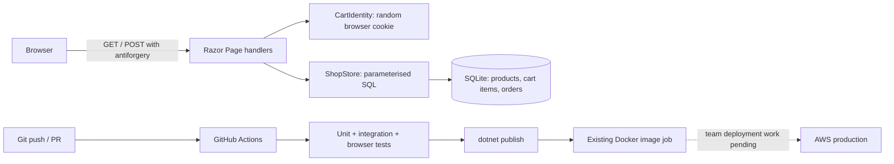

# Architecture and code walkthrough

## Request and deployment paths

Razor Pages render HTML on the server. Standard forms work without JavaScript. Each page's `.cshtml` describes the view and `.cshtml.cs` handles requests. Dependency injection supplies a shared `ShopStore` and a per-request `CartIdentity`.

## Find the relevant code

| File | Responsibility |
| --- | --- |
| `Program.cs` | Configure services, database path/keys, initialize schema, map pages and health checks |
| `Models/ShopModels.cs` | Product/cart/order records, cent-based totals, quantity limits and AUD formatting |
| `Services/ShopStore.cs` | SQLite schema, catalogue queries, cart changes and transactional checkout |
| `Services/CartIdentity.cs` | Validate/create random anonymous cart cookie; rotate for the next purchase |
| `Pages/Index.cshtml.cs` | Category filtering and add-to-cart handler |
| `Pages/Cart.cshtml.cs` | Update/remove/checkout handlers and user-facing validation messages |
| `Pages/Confirmation.cshtml.cs` | Look up a receipt for its owning cart; return 404 otherwise |
| `Pages/Shared/_Layout.cshtml` | Shared navigation, cart badge and footer |
| `Pages/Shared/_ProductArt.cshtml` | Local, code-editable product illustrations |
| `wwwroot/css/site.css` | Shared desktop and mobile styling |

All application paths in this table are relative to the inner `SoftwareDeploymentProject/` directory.

## Example: a shopper places an order

1. The first page request creates a random 128-bit cart ID in an HttpOnly, SameSite=Lax cookie. The browser sends it on later requests. The cookie carries no product prices or personal details.
2. The add form posts a product ID and quantity with a Razor-generated antiforgery token. The handler validates input and calls `ChangeQuantity`.
3. The store validates the product against the database, enforces the 1–20 limit including accumulated additions, and saves the quantity with parameterised SQL. A redirect prevents ordinary browser refresh from repeating the POST.
4. The cart view reads product prices from the database and calculates totals in integer cents. Submitted price fields have no effect.
5. Checkout acquires a SQLite write transaction, checks for a previous order for this cart, reads current cart items, saves the order and item-price snapshots, and clears cart items before committing. An exception rolls back the transaction.
6. The handler redirects to a receipt. Both the reference and owning cart cookie must match. Repeating checkout for the same cart returns the original receipt.
7. Adding another product after checkout rotates the cookie to a fresh cart. Old receipt access is intentionally limited: this demo has no accounts or order history.

SQLite serialises write transactions. A unique `orders.cart_id` constraint is an additional duplicate-order safeguard. A stale update after checkout is rejected. The test suite includes concurrent checkout attempts. This does not turn the application into a high-throughput ecommerce platform.

## Database schema

| Table | Fields / constraints | Purpose |
| --- | --- | --- |
| `products` | `id` PK; name, category, description, positive price in cents, icon | Seeded catalogue |
| `cart_items` | composite PK (`cart_id`,`product_id`); product FK; quantity 1–20 | Anonymous carts |
| `orders` | random `reference` PK; unique `cart_id`; UTC timestamp; positive total cents | One immutable order per completed cart |
| `order_items` | order FK; product name, unit price cents, quantity snapshot | Preserve what was ordered even if the catalogue changes |

Foreign keys are enabled on every connection. WAL journaling is enabled at initialization. Connections are short lived and disposed; the store itself can be a singleton because it holds only a connection string. Multi-step writes use transactions. Product seed values are illustrative AUD prices. There are no delivery charges or additional tax calculations; the displayed item prices sum directly to the total.

## Decisions and limits

- **Keep .NET Razor Pages:** compatible with Judah's existing project, publish workflow and runtime image; avoids introducing a separate frontend build and API.
- **SQLite:** one file and no database server credentials makes the project easy to run. Suitable for a single-instance demo, with persistent local storage. Multiple production replicas or substantial write traffic call for a server database and migration work.
- **Direct Microsoft.Data.Sqlite:** a small schema and parameterised queries are visible to teammates. An ORM/migration framework would add setup for limited benefit here. Schema changes must be reviewed; `CREATE IF NOT EXISTS` is not a migration system.
- **Integer cents:** exact arithmetic for these prices and quantity limits. No floating-point rounding surprises.
- **Simulated checkout:** demonstrates persistence and verification without payments or personal data. There is no stock reservation, sizing, refunds, delivery integration or admin interface.
- **Anonymous browser cookie:** lightweight and private for the demo. Not authentication; possession of the random cookie gives access to that cart. Protect transport with HTTPS in public deployments. There is no cross-device recovery.
- **Local assets:** no external fonts, images, scripts or frontend dependency downloads are needed to render the shop.

Razor output encoding and antiforgery defaults remain enabled. No user input is interpolated into SQL. HTTPS termination and traffic limits belong to the deployment layer. `Shop__SecureCookies=true` is required behind a public HTTPS proxy because the app's internal container connection may be HTTP.

## References

- [Microsoft: Razor Pages with data](https://learn.microsoft.com/aspnet/core/data/ef-rp/intro?view=aspnetcore-10.0) — framework background; this project uses direct SQLite rather than EF.
- [Microsoft: antiforgery protection](https://learn.microsoft.com/aspnet/core/security/anti-request-forgery?view=aspnetcore-10.0) — Razor form protection.
- [Microsoft.Data.Sqlite overview](https://learn.microsoft.com/dotnet/standard/data/sqlite/) — database provider.
